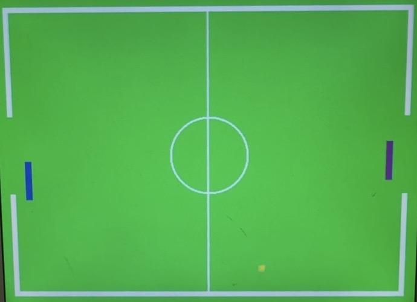
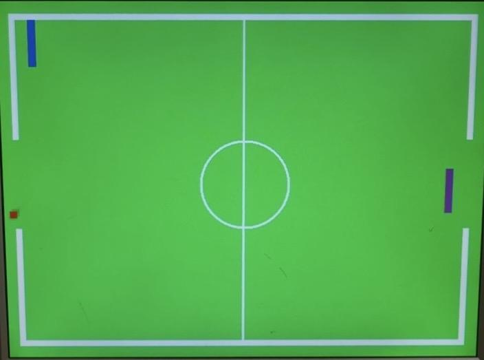
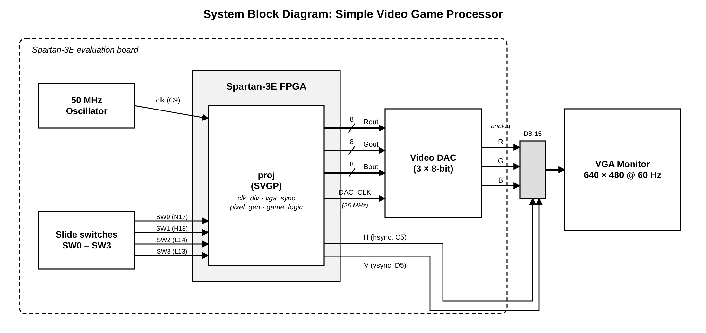
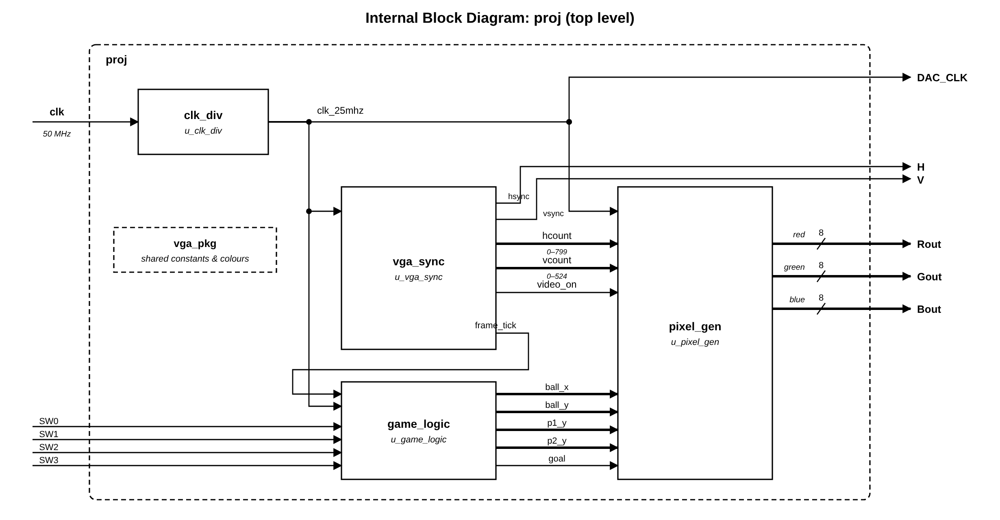
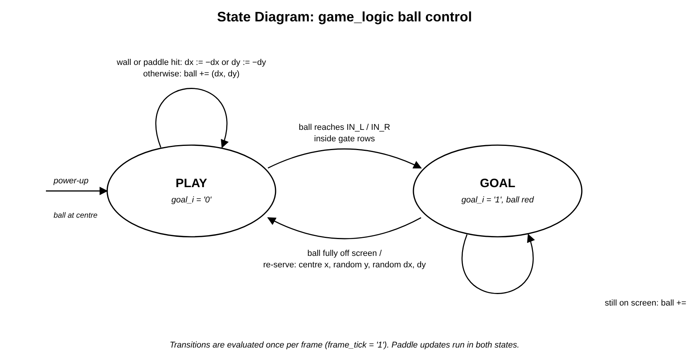

# FPGA Pong: VGA Video Game in VHDL

A two-player Pong game built entirely in hardware on a Xilinx Spartan-3E FPGA. It's written in VHDL and outputs 640 x 480 @ 60 Hz VGA. There's no CPU and no frame buffer: every pixel's colour is computed in real time from the beam position and the game state.

Built for COE 758 (Digital Systems Engineering) at Toronto Metropolitan University, Fall 2026.

  
  

## Features

- 640 x 480 @ 60 Hz VGA timing generated from a 25 MHz pixel clock
- Green field with a white border, an open gate on each side, a centre line and a centre circle
- Two paddles controlled by slide switches (SW0/SW1 left, SW2/SW3 right)
- The ball bounces off the walls and paddles, turns red when it enters a gate, and is served again from the centre
- Random serve height and direction from a 16-bit LFSR
- Game state updates once per frame (during vertical blanking), which gives a fixed speed and no tearing
- The centre circle is drawn with an x² + y² test on the FPGA's built-in multipliers

## Architecture

| File | What it does |
| --- | --- |
| `proj.vhd` | Top level that wires the modules together and maps them to the board pins |
| `clk_div.vhd` | Divides the 50 MHz board clock by 2 to get the 25 MHz pixel clock |
| `vga_sync.vhd` | Runs the horizontal (0 to 799) and vertical (0 to 524) counters. Generates active-low H/V sync, `video_on` and a once-per-frame `frame_tick` |
| `pixel_gen.vhd` | Chooses each pixel's colour with a priority chain: blanking, ball, paddles, border, centre line, centre circle, field |
| `game_logic.vhd` | Paddle movement, ball motion, collision detection, goal detection and the LFSR-based serve |
| `vga_pkg.vhd` | Shared timing constants, field geometry and colour definitions |
| `proj.ucf` | Pin constraints for the Spartan-3E board |

### VGA timing (640 x 480 @ 60 Hz)

| | Visible | Front porch | Sync | Back porch | Total |
| --- | --- | --- | --- | --- | --- |
| Horizontal (pixels) | 640 | 16 | 96 | 48 | 800 |
| Vertical (lines) | 480 | 10 | 2 | 33 | 525 |

### Game state

More block, state and process diagrams are in [`diagrams/`](diagrams/), and the full write-up is in the [project report](<Project2 Simple Video Game Processor (Pong).pdf>).

## Controls

| Switch | Action |
| --- | --- |
| SW0 / SW1 | Left paddle up / down |
| SW2 / SW3 | Right paddle up / down |

## Building and running

1. Create a Xilinx ISE project for the Spartan-3E and add all the `.vhd` files plus `proj.ucf`.
2. Set `proj` as the top module.
3. Under Generate Programming File > Process Properties > Startup Options, set **FPGA Start-Up Clock** to **JTAG Clock**.
4. Synthesize, implement and generate the bitstream, then program the board with iMPACT.
5. Connect a VGA monitor and play.

## What I learned

- Generating real-time video signals with counters and comparators
- Writing synchronous VHDL with one clock domain and registered outputs
- Designing a frame-based game update to avoid tearing
- Pseudo-random number generation in hardware with an LFSR
